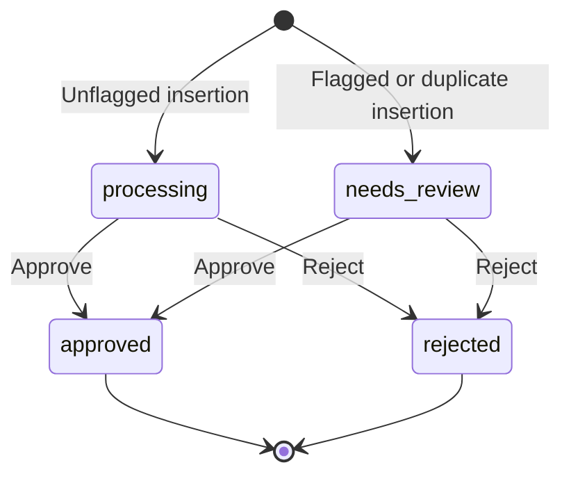

# Schema and lifecycle

## `invoices`

| Column            | SQLite type | Constraints / purpose                                           |
| ----------------- | ----------- | --------------------------------------------------------------- |
| `id`              | INTEGER     | Primary key                                                     |
| `invoice_number`  | TEXT        | Required; not unique because duplicate submissions are retained |
| `vendor_name`     | TEXT        | Required                                                        |
| `amount`          | INTEGER     | Required, nonnegative integer cents                             |
| `currency`        | TEXT        | Required, three-character currency code; seed uses USD          |
| `invoice_date`    | TEXT        | Required; date-only `YYYY-MM-DD`                                |
| `due_date`        | TEXT        | Required; date-only `YYYY-MM-DD`                                |
| `description`     | TEXT        | Required                                                        |
| `status`          | TEXT        | Required; CHECK limits to four statuses                         |
| `duplicate_of_id` | INTEGER     | Nullable self-referencing FK; cannot equal own ID               |
| `flag_reason`     | TEXT        | Nullable explanation; may flag a nonduplicate for manual review |
| `created_at`      | TEXT        | Required ISO 8601 UTC timestamp                                 |
| `updated_at`      | TEXT        | Required ISO 8601 UTC timestamp                                 |
| `decided_at`      | TEXT        | Required for final states, NULL for pending states              |
| `decision_note`   | TEXT        | Nullable, trimmed optional decision note                        |

Indexes: `(status, created_at DESC)` for filtering and `(lower(trim(vendor_name)), lower(trim(invoice_number)), amount)` for duplicate lookup. Foreign keys are enabled on every connection. WAL journal mode and a 5-second busy timeout are set at connection time.

`app_metadata(key TEXT PRIMARY KEY, value TEXT NOT NULL)` holds the `seed_v1` marker. The marker and six records are written in one immediate transaction. This is seed versioning, not a general-purpose migration framework. The schema definition in `server/src/database.ts` is the authoritative DDL.

## Status lifecycle

The PATCH status endpoint allows exactly four final-decision transitions: processing → approved, processing → rejected, needs_review → approved, needs_review → rejected. Approved and rejected are terminal; repeat decisions, even to the same status, return 409. The separate full-form editing endpoint may move a pending invoice between processing and needs_review; detected duplicates always remain needs_review. The seed additionally includes one pre-decided approved and one pre-decided rejected example, with decision timestamps assigned on insertion.

An immediate transaction performs the lookup and conditional UPDATE. The UPDATE changes status, decision note, decision time, and update time together only if the current status is pending. No automatic decision is inferred from a duplicate flag.

## Duplicate handling

`findDuplicate(db, invoice)` in `repository.ts` compares:

1. Vendor name after SQLite `lower(trim(...))` normalization.
2. Invoice number with the same normalization.
3. Exact integer amount in cents.

It excludes the current record during edits and only matches original records (`duplicate_of_id IS NULL`), avoiding circular references. It returns the earliest matching record by `created_at ASC, id ASC`. SQLite's built-in `lower` primarily handles ASCII; this deliberately simple matcher does not perform Unicode folding, fuzzy matching, punctuation removal, or vendor identity resolution. Currency is not part of the required matching key, so equal cents in different currencies may be flagged for human review.

`InvoiceRepository.create` calls this function inside its insertion transaction. Any match overrides the incoming status to `needs_review`, sets `duplicate_of_id` to the original ID, and sets `flag_reason` to `Possible duplicate of {original.invoice_number}`. All matching happens against persisted records; record 4 in the seed naturally references record 1. An approved or rejected original still participates in detection.

The detail endpoint includes the original record as a nonrecursive object. The UI shows a warning and expandable original preview, letting a reviewer decide deliberately. A subsequent decision retains the duplicate reference and flag so the context is not lost.

## Create/edit API in v2

`POST /api/invoices` validates all user input before transactional insertion. `PATCH /api/invoices/:id` validates a full editable form and refuses final-state edits. Both recompute duplicate flags. The database schema is unchanged, so existing v1 databases and decisions are preserved without migration or reseeding. Referenced originals have immutable identity/money fields to retain a trustworthy original comparison. UI search, filtering, sorting and CSV export do not change stored records.
